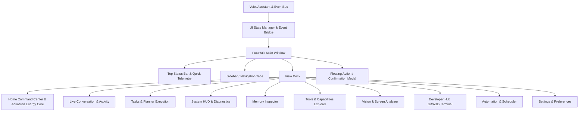

# FRIDAY V3 / V4 — Futuristic Personal AI Command Center & HUD Upgrade
## UI Implementation Plan (`UI_IMPLEMENTATION_PLAN.md`)

---

## 1. Existing GUI Architecture & Audit

### Existing GUI Overview (`gui.py`)
- **Framework:** Python standard `tkinter` + `ttk`.
- **Layout:** Vertical stack (Window title -> State badge -> 100x100 Tkinter Canvas Orb -> Status label -> Task progress bar -> Response text box -> Quick action buttons -> Text input bar).
- **Communication:** Subscribed to `global_event_bus` (`assistant.state_change`, `stt.transcript`, `assistant.response`) and polled `global_telemetry` at 1Hz.

### Limitations of Current GUI
1. **Monolithic Single-View Layout:** Everything is crammed into a single vertical 500x700 window without dedicated tabs for Memory, Tools, Vision, Developer, Tasks, and Settings.
2. **Basic Canvas Orb:** The orb is a static 2D circle with simple sinusoidal scaling, lacking multi-ring energy depth, particle orbital dynamics, and audio frequency waveform integration.
3. **No Interactive Permission Modal:** Confirmation requests for high-risk tools (`apps.close`, destructive terminal ops) are rendered as plain text in the transcript rather than an interactive modal dialog with [ALLOW] / [DENY].
4. **No Direct Tool/Memory Exploration:** Users cannot browse memories, view registered tools, inspect Git branches, or manage background task queues directly from the UI.
5. **No Compact Floating Pill Mode:** Cannot minimize into a non-intrusive floating desktop widget.

---

## 2. Reusable vs Modifiable vs New Components

### Components to Reuse
- `core/event_bus.py`: Asynchronous dispatch between backend and UI.
- `core/telemetry.py`: Latency phase metrics and real-time audio health.
- `core/agent/task_manager.py`: Live task state machine and step progress.
- `core/memory/manager.py`: Semantic memory store, search, and recall.
- `desktop_controller.py`: Low-level Windows OS diagnostics.
- `core/tools/base.py`: Tool registry and parameter introspection.

### Components to Upgrade / Create
1. **`ui/theme.py`:** Dark futuristic palette, custom Tkinter font definitions, elevation colors, status tints, and canvas drawing styles.
2. **`ui/core_canvas.py`:** High-performance 60 FPS animated energy core with rotating particle rings, glowing pulse shaders, and real-time audio waveform equalizer.
3. **`ui/views/home.py`:** Command center with central Core, audio waveform, active status card, recent history cards, and quick actions.
4. **`ui/views/conversation.py`:** Scrollable bilingual chat feed with streaming tokens, copy/inspect buttons, and Hinglish indicators.
5. **`ui/views/tasks.py`:** Live planner step breakdown (checks, dots, circles, crosses), repair attempt indicators, background tasks list with cancel/pause.
6. **`ui/views/system_hud.py`:** Hardware dials for CPU, GPU VRAM, RAM, Battery, Disk, Network, and Turn Latency charts.
7. **`ui/views/memory.py`:** Categorized memory explorer (Projects, Preferences, Facts) with search and forget buttons.
8. **`ui/views/tools.py`:** Category-grouped toolbox (Windows, Files, Browser, Vision, Developer, Android, Git, Memory) with parameter inspection and safe execution runner.
9. **`ui/views/vision.py`:** Screen capture preview and UI element bounding box/OCR explorer.
10. **`ui/views/developer.py`:** Git branch/status/diff viewer, Android ADB device manager, and terminal runner.
11. **`ui/views/automation.py`:** Active timers, reminders, and scheduled routines.
12. **`ui/views/settings.py`:** Live settings editor for wake-word, models, voices, and UI options.
13. **`ui/components/confirmation_dialog.py`:** High-risk permission approval modal.
14. **`gui.py`:** Modular entrypoint integrating all views with seamless desktop pill minimization.

---

## 3. Event & State Integration Plan

- **UI Thread Safety:** All event handlers received via `EventBus` or background worker threads are queued to Tkinter via `root.after(0, ...)`.
- **Zero Latency Impact:** UI rendering and canvas animations run on a 30-60 FPS timer with double-buffered canvas tags (`delete("anim")`), preventing garbage collection stalls and never blocking the audio pipeline.
- **Asynchronous Telemetry Polling:** System metrics (CPU/RAM/GPU) are collected on a background daemon worker thread every 1.5s.

---

## 4. Implementation Phases

- **Phase 1:** Create `ui/theme.py` with futuristic cyberpunk / glassmorphism color palette and typography.
- **Phase 2:** Implement `ui/core_canvas.py` with multi-ring rotating particle core and audio waveform.
- **Phase 3:** Build `ui/views/` (Home, Conversation, Tasks, System HUD, Memory, Tools, Vision, Developer, Automation, Settings).
- **Phase 4:** Build `ui/components/confirmation_dialog.py` for permission approvals.
- **Phase 5:** Assemble `gui.py` integrating all views and compact mode.
- **Phase 6:** Create unit tests in `tests/test_v4_ui.py` and run full regression suite.
- **Phase 7:** Generate `FRIDAY_UI_IMPLEMENTATION_REPORT.md` with verification metrics.
